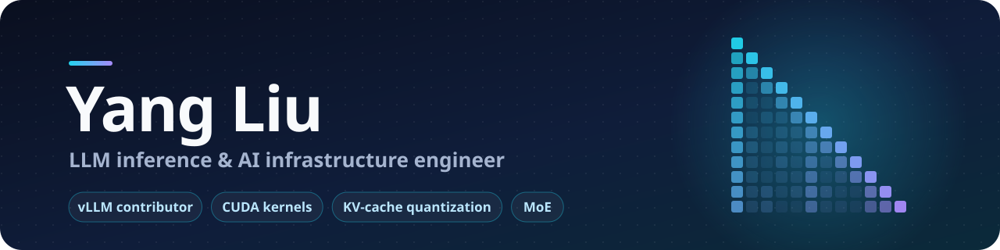

  

## Hi, I'm Yang

I contribute to vLLM and RL-Kernel, and I have 3+ years of full-stack experience in the U.S.

  
  
  

## What I work on

**Truckpedia**
- GLM-4.6V runs at W8A8C8 with calibrated FP8 KV-cache scales, on a TP4×DP2 + EP8 + SP layout chosen by measurement. Removing a CPU bottleneck under structured output raised throughput 1.86×.

**vLLM** (5 merged PRs)
- Removed 24 per-block CUDA device-to-host syncs from the GLM-4.xV vision encoder: ViT time down about 10%, multimodal prefill down about 5%.
- Computed GLM-4.xV M-RoPE positions from `mm_position`: 6.1× faster on images and 3.2× on video. Fixed video tokens being treated as text along the way.
- Co-authored support for the Isaac-0.1 multimodal model, and moved the request Processor out of `AsyncLLM`.

**RL-Kernel**
- A deterministic CUDA backward kernel for the DeepSeek-V4 MoE router, with 28 tests on H100 that include bit-for-bit comparison against a reference implementation.

**Side projects**
- INT8 KV cache in a vLLM fork: same accuracy as BF16 on GSM8K and HumanEval, twice the KV capacity.
- CUDA kernels on H100: LayerNorm and RMSNorm at about 81% of peak bandwidth, GEMM at 75% of cuBLAS.
- MoE all-to-all dispatch and combine written from scratch, with outputs matching DeepEP V2.

## Tech stack

**AI infrastructure** 

**Backend & cloud** 

